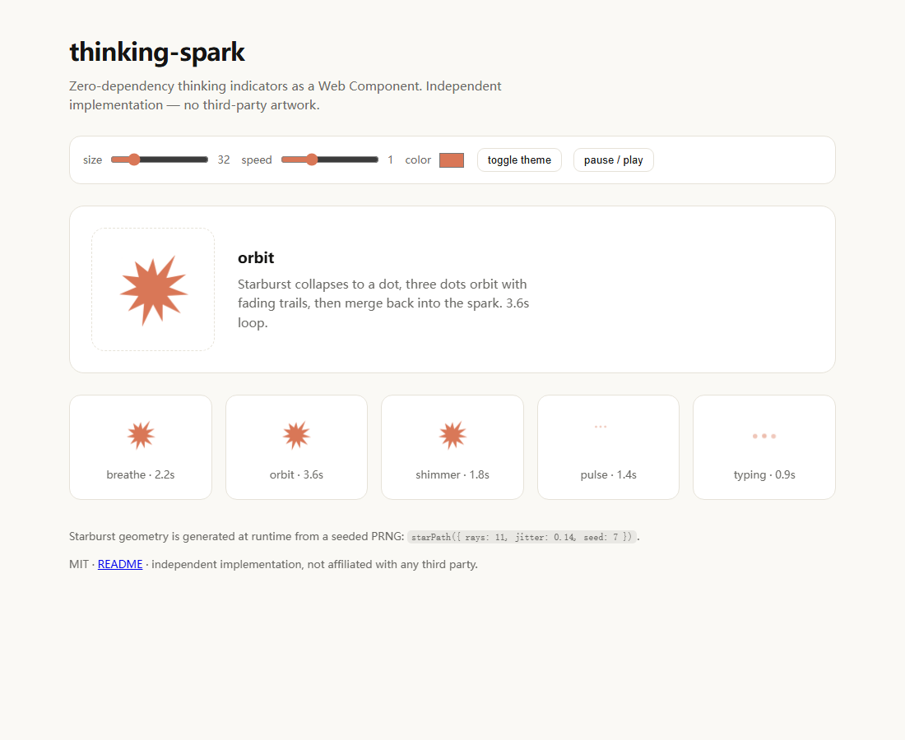

# thinking-spark

Zero-dependency animated **thinking indicators** packaged as a tiny Web Component.
Five variants, one tag, no build step.

```html
<thinking-spark variant="orbit" size="24" color="#d97757"></thinking-spark>
```



> Independent implementation. Not affiliated with Anthropic. No third-party assets included.

## Variants

| `variant` | What it does | Loop |
| --- | --- | --- |
| `breathe` | starburst contracts to a spark and back | 2.2s |
| `orbit` | starburst collapses to a dot, three dots orbit with trails, merge back | 3.6s |
| `shimmer` | rays fade into a dotted ring that rotates and re-forms | 1.8s |
| `pulse` | three dots pulse in sequence | 1.4s |
| `typing` | three dots bounce like a typing indicator | 0.9s |

## Install

```bash
npm install thinking-spark
```

Or drop `src/thinking-spark.js` on a page directly:

```html
<script type="module" src="/thinking-spark/src/thinking-spark.js"></script>
<thinking-spark variant="breathe"></thinking-spark>
```

## Attributes

| Attribute | Default | Description |
| --- | --- | --- |
| `variant` | `breathe` | one of `breathe`, `orbit`, `shimmer`, `pulse`, `typing` |
| `size` | `24` | any CSS length: `32`, `2rem`, `1.5em` |
| `color` | `#d97757` | any CSS color |
| `speed` | `1` | playback rate, e.g. `0.75` slower, `2` faster |
| `label` | `Thinking` | accessible name; `none` hides it from AT |
| `paused` | – | freezes the animation |

CSS custom properties `--ts-size` and `--ts-color` are also supported.

## JavaScript

```js
const spark = document.querySelector('thinking-spark');
spark.setAttribute('variant', 'orbit');
spark.setAttribute('speed', '0.8');
spark.toggleAttribute('paused', true);
```

The starburst geometry is available on its own:

```js
import { starPath } from 'thinking-spark/star';
const d = starPath({ rays: 12, inner: 0.42, jitter: 0.18, seed: 3 });
```

## Behaviour

- Honours `prefers-reduced-motion: reduce` by rendering a static spark.
- Safe in SSR: the module only touches `customElements` in the browser.
- ~4 KB minified, no runtime dependencies.

## Browser support

Custom Elements v1 + Web Animations API + SVG `transform-box`.
Chrome/Edge 84+, Safari 13.1+, Firefox 75+.

## Development

```bash
npx serve .        # or any static server
# open http://localhost:3000/demo/
```

## License

MIT. See [LICENSE](./LICENSE) and [NOTICE](./NOTICE).

"Claude" and any related marks belong to their respective owners; this project
does not claim affiliation and ships no third-party artwork.
